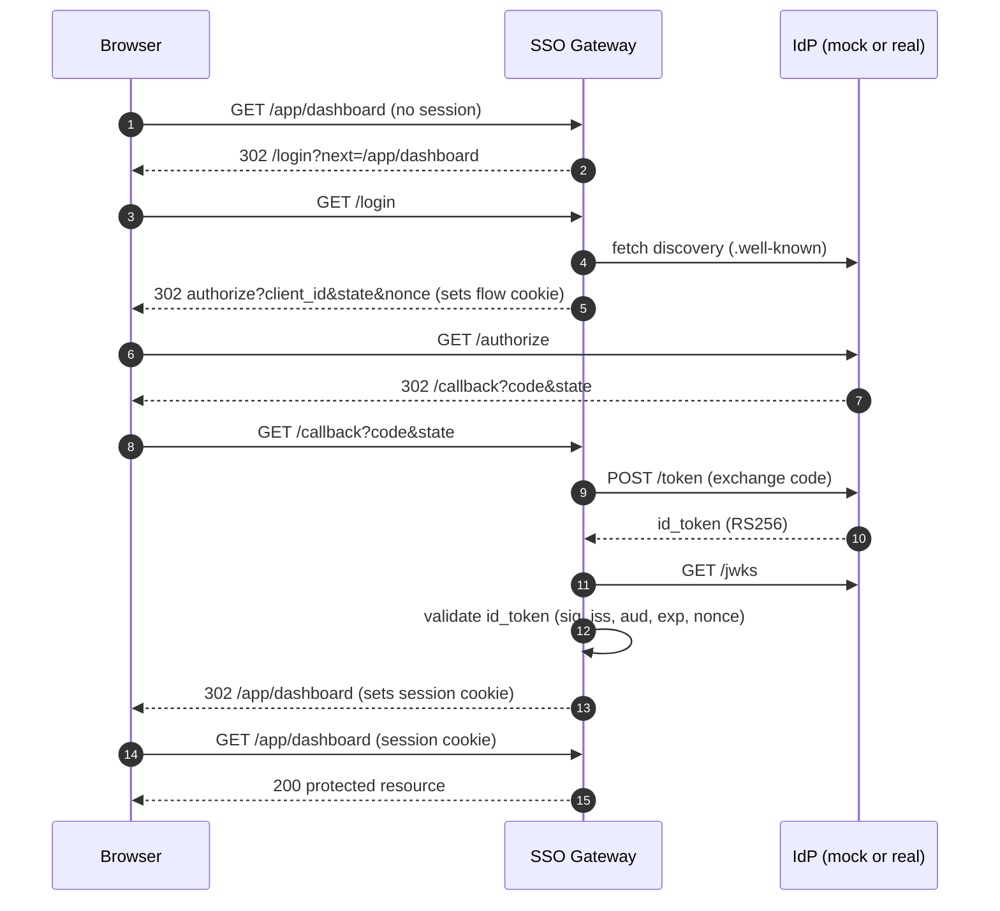

# OIDC SSO Gateway

> A small FastAPI gateway that protects downstream routes by requiring a valid OpenID Connect session — ships with a bundled mock IdP so it runs and tests fully offline.


## Overview

This gateway sits in front of one or more protected routes and enforces
authentication using the **OpenID Connect Authorization Code flow**. A request
to a protected path without a valid session is 302-redirected to the identity
provider (IdP) to log in; on return, the gateway validates the ID token, issues
a signed session cookie, and lets the request through.

To keep the project self-contained and testable with no external dependencies,
it ships a **bundled mock OIDC provider** that issues RS256-signed ID tokens
backed by a locally generated key and a JWKS endpoint. The default configuration
targets this mock, so `pytest` and `uvicorn` both work offline. Pointing at a
real IdP (Google, Auth0, Entra ID, Keycloak, …) is a matter of environment
variables — see [Using a real IdP](#using-a-real-idp).

> Honesty note: the default identity provider is a **mock** intended for local
> development and tests only. It auto-approves logins and is not a hardened IdP.

## Architecture



## Features

- OIDC **Authorization Code flow**: `/login`, `/callback`, `/logout`.
- Protected **`/app/*` passthrough** that 302s to `/login` when unauthenticated.
- **RS256 ID-token validation** against a JWKS document (PyJWT), checking
  signature, `iss`, `aud`, `exp`/`iat`, and the login-bound `nonce`.
- **CSRF-safe** flow with `state` + `nonce` carried in a short-lived signed cookie.
- **Signed session cookies** (`itsdangerous`) — `HttpOnly`, `SameSite=Lax`, and
  `Secure` when served over HTTPS.
- **Bundled mock IdP** with a locally generated RSA key — runs fully offline.
- **Discovery-driven**: point at any real IdP via its `.well-known` URL.
- **Injectable `httpx` client** so the whole flow is exercised in-process by tests.

## Tech stack

| Concern            | Choice                                   |
| ------------------ | ---------------------------------------- |
| Web framework      | FastAPI (Starlette) on Python 3.11       |
| HTTP client        | httpx (async, injectable for tests)      |
| Token validation   | PyJWT (RS256 / JWKS)                      |
| Mock IdP signing   | `cryptography` (RSA-2048 keygen)         |
| Session cookies    | itsdangerous (signed, timestamped)       |
| Tests              | pytest + Starlette `TestClient`          |

## Getting started

Requires Python 3.11+.

```bash
pip install -e ".[dev]"      # installs the gateway and pytest
cp .env.example .env         # optional; defaults already target the mock IdP
uvicorn ssogateway.main:app --reload
```

The server starts at `http://localhost:8000` with the mock IdP mounted at
`/mock-idp`. No external identity service is needed.

## Usage

Walk through the flow with the mock IdP:

1. Open `http://localhost:8000/app/dashboard`. Because you have no session, the
   gateway redirects you to `/login`.
2. `/login` redirects to the IdP `authorize` endpoint. The mock auto-approves
   and redirects back to `/callback` with an authorization `code` and `state`.
3. `/callback` exchanges the code for tokens, validates the ID token against the
   JWKS, sets a signed session cookie, and redirects you back to
   `/app/dashboard`.
4. You now see a JSON response representing the protected upstream, including
   the authenticated identity.

Useful endpoints:

- `GET /` — service status and whether you are authenticated.
- `GET /app/{path}` — protected passthrough (302 to `/login` when unauthenticated).
- `GET /logout` — clears the session cookie.
- `GET /healthz` — liveness probe.

> The `/app/*` handler echoes the request and identity because there is no real
> downstream wired in — it stands in for a reverse proxy to an upstream service.

## Using a real IdP

Set these in `.env` (or the environment) and restart:

```bash
USE_MOCK_IDP=false
OIDC_DISCOVERY_URL=https://<issuer>/.well-known/openid-configuration
OIDC_CLIENT_ID=<your-client-id>
OIDC_CLIENT_SECRET=<your-client-secret>
OIDC_SCOPES=openid profile email
PUBLIC_BASE_URL=https://gateway.example.com
```

Register `PUBLIC_BASE_URL + /callback` as an allowed redirect URI in your IdP.
The gateway reads the `authorization_endpoint`, `token_endpoint`, `jwks_uri`,
and `issuer` from the discovery document, so no per-provider code changes are
required. Examples of discovery URLs:

- Google: `https://accounts.google.com/.well-known/openid-configuration`
- Auth0: `https://<tenant>.auth0.com/.well-known/openid-configuration`
- Keycloak: `https://<host>/realms/<realm>/.well-known/openid-configuration`

## Security notes

- **`state` and `nonce`** are generated per login and stored in a short-lived,
  signed `flow` cookie. `state` is re-checked on the callback (CSRF defense);
  `nonce` is verified inside the ID token (replay/token-injection defense).
- **ID-token validation** enforces the RS256 signature against the JWKS key
  matched by `kid`, plus `iss`, `aud`, presence and freshness of `exp`/`iat`,
  and the `nonce`. Any failure yields a 401 and no session is issued.
- **Cookies** are `HttpOnly` and `SameSite=Lax`, and set `Secure` automatically
  when `PUBLIC_BASE_URL` is HTTPS. The session cookie is signed (not encrypted)
  and carries only identity claims — never secrets. Set a strong random
  `SESSION_SECRET` in production and terminate TLS in front of the gateway.
- The **mock IdP** is for local use only; it does not authenticate real users.

## Project structure

```
oidc-sso-gateway/
├── ssogateway/
│   ├── __init__.py
│   ├── config.py       # env-driven settings
│   ├── session.py      # signed session/flow cookies (itsdangerous)
│   ├── oidc.py         # discovery, authorize URL, code exchange, ID-token validation
│   ├── mock_idp.py     # in-process OIDC provider: /authorize, /token, /jwks, discovery
│   └── main.py         # gateway routes + protected /app/* passthrough
├── tests/
│   ├── conftest.py     # in-process app + injected httpx (ASGI) client
│   └── test_gateway.py
├── .github/workflows/ci.yml
├── .env.example
├── pyproject.toml
├── requirements.txt
├── LICENSE
└── README.md
```

## Testing

```bash
pytest
```

The suite runs entirely offline. It wires the gateway's back-channel `httpx`
client to an ASGI transport over the app itself, so token/JWKS/discovery calls
reach the mounted mock IdP in-process. Coverage includes: unauthenticated
requests redirect to `/login`; the full flow yields a session and access to a
protected route; and tampered, expired, wrong-audience, and nonce-mismatched ID
tokens are all rejected.

## Roadmap

- PKCE (S256) support for public clients.
- Refresh-token handling and silent session renewal.
- RP-initiated logout via the IdP `end_session_endpoint`.
- Real reverse-proxy passthrough to a configurable upstream.
- Pluggable session backend (server-side store) for revocation.

## License

MIT — see [LICENSE](LICENSE).

---

Part of my cloud & AI portfolio — see [github.com/matthews-wong](https://github.com/matthews-wong).
